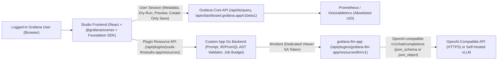

# LLM Dashboard Studio (`yuuki-llmstudio-app`)

An open-source Grafana App Plugin for generating, iteratively refining, previewing, and saving Prometheus/VictoriaMetrics dashboards using OpenAI-compatible APIs or self-hosted local LLMs (vLLM) via [`grafana-llm-app`](https://github.com/grafana/grafana-llm-app) — without requiring Grafana Cloud or Grafana Assistant.

> **Status:** MVP (`0.1.0`) — Supports **Grafana OSS `13.3.1` (React 19)** and **Grafana OSS `12.4.15` (React 18)** (`grafanaDependency: ">=12.4.0 <14.0.0"`).

## Overview

LLM Dashboard Studio lets Grafana users describe what they want to observe in natural language (for example, *"Show request rate, 5xx error rate, and p95 latency for the selected service"*), grounds generation strictly in scoped metrics fetched from an allowlisted Prometheus-compatible datasource, and renders a live preview before saving.

Instead of letting an LLM author raw Grafana Dashboard JSON directly, the LLM produces a tightly constrained **Intermediate Representation (IR)** and **Patch** format. Deterministic validation, PromQL AST/regex safety checks, query execution, live previewing, and dashboard creation are controlled exclusively by the plugin and Grafana.

### Key Features

- **Self-Hosted OSS & Flexible Network Topologies:** Runs on Grafana OSS with zero dependency on Grafana Cloud, Grafana Assistant, or external CDNs. Supports standard internet-connected environments (OpenAI, Azure OpenAI, OpenRouter, Groq, DeepSeek API, Together AI, Fireworks AI, Gemini OpenAI-compatible) as well as isolated or fully air-gapped networks with local vLLM.
- **Unified LLM Routing (`grafana-llm-app`):** All inference traffic flows exclusively through Grafana's plugin resource API to `grafana-llm-app` and then to your configured LLM provider. No direct LLM bypass or duplicate proxy is added.
- **Broad OpenAI-Compatible Protocol Controls:** Supports configurable `structuredOutputMode` (`json_schema` or `json_object`), `tokenLimitField` (`max_completion_tokens` or `max_tokens`), and optional `reasoningEffort` (defaults to omitted for standard models; `low`/`medium`/`high` for reasoning models).
- **Metric-Grounded Generation & Partial Edits:** Fetches scoped metric catalogs (`service` / `job` / `namespace`) in browser memory, narrows candidates with BM25, generates initial drafts, supports targeted panel edits (`patch`), undo, and bounded syntax-only repair.
- **Split-Pane Studio UI:**
  - **Left pane:** Datasource/scope selection, chat input, job status, structural diff, dry-run validation results, folder picker, and save/export actions.
  - **Right pane:** Live `@grafana/scenes` preview (auto-refresh disabled; mounted explicitly after dry-run validation passes), IR JSON inspector, and Foundation SDK JSON inspector.
- **Preview-to-Save Parity:** A single normalization layer (`NormalizedDashboardSpec`) feeds both `@grafana/scenes` (preview) and `@grafana/grafana-foundation-sdk` (saved/exported Classic Dashboard JSON).
- **Create-Only Dashboard Saving:** Uses Grafana's Kubernetes-style Dashboard API (`POST /apis/dashboard.grafana.app/v1beta1/...`) with freshly app-generated UIDs and in-flight locks; on `409 Conflict`, it never falls back to `PUT` or overwrites existing dashboards.

## Architecture



- **Data & Save Boundary:** Metadata discovery, bounded dry-run validation (`now-5m`, `maxDataPoints=10`, concurrency `<=2`), `@grafana/scenes` preview, and dashboard creation all execute from the frontend using the **logged-in user's Grafana session**.
- **LLM Control Plane:** The Go backend owns prompt construction, untrusted-input sanitization, strict IR & PromQL AST validation, per-user job isolation (via Grafana's trusted `PluginContext`), and retry/repair budgets. The LLM service account token is never reused for datasource queries or dashboard writes.

## Compatibility

This plugin intentionally pins and verifies concrete target versions rather than claiming blanket compatibility across all Grafana releases.

| Component | Supported / Pinned Version | Notes |
|---|---|---|
| **Grafana OSS** | **`13.3.1`** (React 19) / **`12.4.15`** (React 18) | `plugin.json` declares `>=12.4.0 <14.0.0`; `react/jsx-runtime` & `react/jsx-dev-runtime` externalized |
| **`grafana-llm-app`** | **`v1.2.0`** (Grafana 13.x) / **`v1.0.8`** (Grafana 12.4.x) | Unified LLM relay (`/resources/llm/v1/chat/completions`) for OpenAI-compatible APIs or local vLLM |
| **Go `llmclient`** | `v0.20.0` (`go-openai v1.41.1`) | Official Go client for `grafana-llm-app` |
| **`@grafana/scenes`** | `9.3.0` | Supports React 18 & 19 (`^18.0.0 \|\| ^19.0.0`) and `@grafana/runtime >=12.4` |
| **`@grafana/grafana-foundation-sdk`** | `0.0.22` | Generates Classic Dashboard JSON (`schemaVersion: 42`) |
| **`grafana-plugin-sdk-go`** | `v0.278.0` | `ProtocolVersion = 2` (wire-compatible with Grafana 12.4.x and 13.x) |
| **LLM Backends (via `grafana-llm-app`)** | OpenAI / OpenAI-compatible APIs or local `vLLM >= v0.12.0` | Supports `json_schema` / `json_object` and `max_completion_tokens` / `max_tokens`; model-agnostic via `base`/`large` |
| **Build Toolchain** | Node.js `>=22.0.0`, Go `1.24.3` | Reproducible builds (`npm ci` + `go mod vendor` supported for offline packaging) |

See [`docs/compatibility.md`](docs/compatibility.md) for the full source-verified matrix and [`docs/openai-compatible-apis.md`](docs/openai-compatible-apis.md) for provider-by-provider setup.

## Quick Start (Local Development)

The included Docker Compose stack launches Grafana OSS, Prometheus (with query guardrails), and a lightweight Python sample exporter emitting RED and resource metrics (`service="checkout-api"`), with the plugin pre-provisioned in explicit development mock mode.

### Prerequisites

- Node.js `>= 22.0.0` and npm
- Go `1.24.x`
- Docker & Docker Compose

### 1. Install dependencies & build the plugin

```bash
npm ci
go mod download
make verify
```

### 2. Start the local stack

```bash
cp deploy/.env.example deploy/.env
# Defaults to Grafana OSS 13.3.1 (React 19).
# To test against Grafana OSS 12.4.15 (React 18), run: GRAFANA_VERSION=12.4.15 docker compose ...
docker compose -f deploy/docker-compose.yml up -d
```

To connect directly to an **OpenAI or OpenAI-compatible API** via `grafana-llm-app` in an internet-connected environment, launch with the included compose override (`deploy/docker-compose.openai.yml`) — see [`docs/openai-compatible-apis.md`](docs/openai-compatible-apis.md).

### 3. Try the Studio workflow

1. Open Grafana at `http://localhost:3000` (default dev credentials are in `deploy/.env`).
2. Navigate to **LLM Dashboard Studio** (`/a/yuuki-llmstudio-app`).
3. Select datasource **`Prometheus Main (prom-main)`**, enter scope `service = checkout-api`, and click **Fetch Scoped Metrics**.
4. Enter a prompt, generate a draft, click **Validate & Preview** (runs bounded dry-run queries before mounting Scenes), test a partial panel edit or undo, and save as a new dashboard or export the Foundation SDK JSON.

## Production Deployment

1. **Install the multi-architecture release archive** (`yuuki-llmstudio-app-<version>.zip` or `.tar.gz`, bundling Go backend binaries for `linux/amd64`, `linux/arm64`, `darwin/amd64`, `darwin/arm64`, and `windows/amd64`) after verifying `SHA256SUMS`:
   ```bash
   sha256sum -c SHA256SUMS
   unzip -q yuuki-llmstudio-app-<version>.zip -d /var/lib/grafana/plugins
   ```
2. **Use a signed plugin release (recommended)** so production Grafana instances do **not** require `allow_loading_unsigned_plugins` — see [`docs/plugin-signing-and-publishing.md`](docs/plugin-signing-and-publishing.md) for Private signing (`@grafana/sign-plugin --rootUrls ...`) and Community catalog signing. Only if deploying an unsigned archive, allowlist **only** this plugin ID in `grafana.ini`:
   ```ini
   [plugins]
   allow_loading_unsigned_plugins = yuuki-llmstudio-app
   ```
3. **Install and configure `grafana-llm-app`** (`v1.2.0` for Grafana 13.x or `v1.0.8` for Grafana 12.4.x) pointing either to an OpenAI / OpenAI-compatible HTTPS API (`provider: "openai"`, `"azure"`, or `"custom"`) or your self-hosted vLLM server (`provider: "custom"`, TLS, API key), with `base` / `large` model mappings.
4. **Create a dedicated Grafana Service Account** with the minimum OSS basic role **`Viewer`** (never `Editor` or `Admin`) and store its token in **Plugin Configuration → `llmServiceAccountToken` (`secureJsonData`)**.
5. **Switch `llmMode` to `grafana-llm-app`** and remove development provisioning files (`deploy/grafana/provisioning/plugins/llm-studio-dev.yaml`). Production mode never silently falls back to mock mode.
6. **Enforce upstream query limits** on Prometheus (`--query.timeout`, `--query.max-concurrency`, `--query.max-samples`) or VictoriaMetrics (`-search.maxQueryDuration`, `-search.maxConcurrentRequests`, `-search.maxSeries`). Browser-side dry-run caps are UX guardrails, not a DoS boundary.

- **Internet-connected OpenAI / OpenAI-compatible APIs** (OpenAI, Azure OpenAI, OpenRouter, Groq, DeepSeek, Together, Fireworks, Gemini): see [`docs/openai-compatible-apis.md`](docs/openai-compatible-apis.md).
- **Strictly offline / air-gapped environments** (offline Grafana flags, `-airgap.tar.gz` bundle, digest-pinned image/plugin/model bundling, local vLLM): see [`docs/airgapped-deployment.md`](docs/airgapped-deployment.md).
- **Multi-architecture releases, `@grafana/sign-plugin`, and Grafana Catalog submission:** see [`docs/plugin-signing-and-publishing.md`](docs/plugin-signing-and-publishing.md).

## Configuration Reference

Configured via **Administration → Plugins → LLM Dashboard Studio** (`jsonData` / `secureJsonData`):

| Setting | Storage | Default | Bounds / Allowed Values | Description |
|---|---|---|---|---|
| `allowedDatasourceUids` | `jsonData` | `[]` | Prometheus-compatible UIDs | Allowlist of datasources selectable in Studio; LLMs cannot choose arbitrary UIDs |
| `llmMode` | `jsonData` | `"grafana-llm-app"` | `"grafana-llm-app"`, `"mock"` | Inference backend mode (`"mock"` requires `allowMockInDev: true`) |
| `allowMockInDev` | `jsonData` | `false` | `boolean` | Explicit opt-in for dev/test mock mode; normalized to `false` outside mock mode |
| `grafanaUrl` | `jsonData` | `"http://localhost:3000"` | Loopback or same-origin `AppURL` | Internal Grafana URL used by Go `llmclient` (HTTP redirects disabled) |
| `modelTier` | `jsonData` | `"base"` | `"base"`, `"large"` | Logical model tier mapped by `grafana-llm-app` |
| `structuredOutputMode` | `jsonData` | `"json_schema"` | `"json_schema"`, `"json_object"` | `json_schema` for OpenAI/vLLM/OpenRouter/Gemini; `json_object` for providers without `json_schema` (e.g., DeepSeek API) |
| `tokenLimitField` | `jsonData` | `"max_completion_tokens"` | `"max_completion_tokens"`, `"max_tokens"` | Output token limit field (`max_tokens` for legacy/third-party OpenAI-compatible APIs) |
| `reasoningEffort` | `jsonData` | `""` | `""`, `"low"`, `"medium"`, `"high"` | Omit (`""`) for standard models (`gpt-4o`, `gpt-4.1`, Llama); set `"low"` for reasoning models (`o3`, `gpt-5`, `GLM-5.3`) |
| `llmServiceAccountToken` | `secureJsonData` | *(unset)* | Grafana SA token (`glsa_...`) | Encrypted token dedicated solely to calling `grafana-llm-app` |
| `maxPanels` | `jsonData` | `6` | `1..6` | Maximum panels per generated dashboard |
| `maxRepairAttempts` | `jsonData` | `2` | `0..2` | Maximum syntax-only auto-repair calls per job (`0` disables repair) |
| `maxOutputTokens` | `jsonData` | `2048` | `256..8192` | Output token cap per LLM call |
| `llmTimeoutSeconds` | `jsonData` | `45` | `5..120` | Per-attempt LLM request timeout |
| `jobDeadlineSeconds` | `jsonData` | `90` | `10..180` | End-to-end deadline per generation/patch/repair job |
| `maxConcurrentJobs` | `jsonData` | `4` | `1..16` | Global concurrent LLM job cap per Grafana organization (per-user cap is `1`) |
| `validationTimeoutSeconds` | `jsonData` | `10` | `2..30` | Per-panel dry-run query timeout |
| `maxConcurrentQueries` | `jsonData` | `2` | `1..4` | Concurrent dry-run query cap in the browser |
| `enableSseProgress` | `jsonData` | `false` | `boolean` | Opt-in decoupled SSE stage-progress streaming over `CallResource` (`generating` -> `validating_ir` -> `awaiting_preview`, never raw LLM tokens); requires reverse-proxy `proxy_buffering off` and HTTP/1.1, with graceful non-streaming fallback |
| `jobStoreBackend` | `jsonData` | `"memory"` | `"memory"`, `"redis"` | Job storage backend (`"memory"` zero-dependency default; `"redis"` for HA multi-replica persistence) |
| `jobTtlMinutes` | `jsonData` | `30` | `1..1440` | Automatic expiration TTL (minutes) for idle draft jobs |
| `redisAddr` | `jsonData` | *(unset)* | `host:port` or `[ipv6]:port` | Single-endpoint Redis/Valkey server or cluster proxy address (required when `jobStoreBackend="redis"`; no URL scheme, whitespace, or credentials) |
| `redisDb` | `jsonData` | `0` | `0..15` | Redis logical database index (use `0` when connecting through a Redis Cluster proxy) |
| `redisKeyPrefix` | `jsonData` | `"llmstudio:jobs"` | `[a-zA-Z0-9:_-]{1,64}` | Redis key namespace prefix wrapped in `{prefix}` hash tag (all Lua scripts access only declared `KEYS[]`) |
| `redisTls` | `jsonData` | `false` | `boolean` | Enable TLS (minimum TLS 1.2) using the container/host system CA trust store |
| `redisUsername` | `jsonData` | *(unset)* | `<= 128` chars | Optional Redis 6+ ACL username |
| `redisPassword` | `secureJsonData` | *(unset)* | Encrypted secret | Optional Redis password stored encrypted in `secureJsonData` (never exposed to browser) |

## Security & Trust Boundaries

- **Trusted Identity & Isolation:** Job ownership is bound to Grafana's server-supplied `PluginContext` (`OrgID` + `User.Login`). Browser-supplied IDs are never trusted for authorization.
- **No Cross-User Metadata Cache:** Metric names, `HELP` strings, and label values are kept strictly in browser memory per session and cleared on organization or datasource switch.
- **SSRF & Redirect Protection:** `grafanaUrl` is restricted to loopback addresses or the Grafana instance's own `AppURL` origin, and `llmclient` disables HTTP redirects.
- **Prompt Injection Defense-in-Depth:** User prompts, metric metadata, LLM outputs, and datasource errors are treated as untrusted input—sanitized, length-bounded, and checked against deterministic schemas, catalog allowlists, and PromQL AST/regex safety rules. Raw URLs, HTML, JavaScript, and arbitrary datasource UIDs are disallowed in the IR.
- **Multi-Tenancy Caveat (Grafana OSS):** Within a single Grafana OSS organization, folder permissions or UI hiding do **not** isolate Prometheus metric access. Serving users with different data-access scopes in production requires separate Grafana organizations paired with upstream credential, tenant, or authorization-proxy isolation (detailed in [`docs/architecture.md`](docs/architecture.md)).

## Development & Verification

```bash
# Run all checks: schema sync, typecheck, Jest tests, Go vet & race tests, builds, and bundle verification
make verify
```

Individual commands:

```bash
npm run verify:schemas   # Bidirectional enum & string-only schema sync (JSON Schema <-> TS <-> Go)
npm run typecheck        # TypeScript strict type checking (src + Playwright E2E)
npm run test:ci          # Jest unit, Scenes/Foundation parity, saver, and UI lifecycle tests
npm run test:release     # Unit tests for multi-arch build, checksum, and MANIFEST.txt verification helpers
npm run build            # Production Webpack bundle (dist/module.js)
npm run verify:bundle    # Verify dist/module.js externalizes react/jsx-runtime and contains zero SECRET_INTERNALS
go vet ./pkg/...         # Go static analysis
go test -race -count=1 ./pkg/...  # Go unit, PromQL AST, job isolation, and grafana-llm-app contract tests
make build-backend       # Linux amd64 Go plugin binary (dist/gpx_yuuki_llmstudio_app_linux_amd64)
make build-backend-all   # All 5 Go backend targets (linux/amd64, linux/arm64, darwin/amd64, darwin/arm64, windows/amd64)
make package-airgap      # Package .zip, .tar.gz, .zip.sha1, -airgap.tar.gz, and SHA256SUMS + verify all archives
docker compose -f deploy/docker-compose.yml config --quiet
```

### Live E2E Tests (Playwright + `@grafana/plugin-e2e`)

Run end-to-end browser tests against live Grafana `13.3.1` (React 19) or `12.4.15` (React 18) containers:

```bash
make build
npx playwright install chromium
GRAFANA_VERSION=13.3.1 docker compose -f deploy/docker-compose.yml up -d
node scripts/wait-for-stack.mjs
npm run test:e2e
docker compose -f deploy/docker-compose.yml down -v
```

GitHub Actions (`.github/workflows/ci.yml`) runs all verification checks plus the live E2E matrix on both **Grafana `13.3.1` (React 19)** and **Grafana `12.4.15` (React 18)**. Version tags (`v*`) trigger `.github/workflows/release.yml` for multi-architecture Go cross-compilation, optional `@grafana/sign-plugin` signing, archive & air-gapped bundling, `SHA256SUMS` verification, and GitHub Release publication.

### Repository Structure

```text
.
├── .github/workflows/      # GitHub Actions CI (verify + Grafana 13.3.1/12.4.15 E2E) & tag-triggered multi-arch Release workflow
├── pkg/                    # Go backend plugin (IR, PromQL AST validator, prompt builder, llmclient, job manager, plugin handlers)
├── src/                    # TypeScript/React frontend (Studio UI, AppConfig, metadata/BM25, dry-run validator, Scenes & Foundation adapters, saver)
├── tests/e2e/              # Live Playwright / @grafana/plugin-e2e tests
├── schemas/                # Canonical Dashboard IR & Patch JSON Schemas and sample payloads
├── scripts/                # Schema sync verifier, bundle verifier, multi-arch release packager/verifier, and E2E helpers
├── deploy/                 # Local Docker Compose stack (+ optional OpenAI/Redis/VictoriaMetrics overrides), Prometheus config, provisioning templates
└── docs/                   # Architecture, compatibility matrix, signing & publishing, air-gapped & OpenAI-compatible API guides, and ADRs
```

## Known Limitations (MVP Scope)

- **Scope:** Single Grafana organization, Prometheus-compatible datasources (PromQL & VictoriaMetrics MetricsQL), auto-refresh disabled, non-streaming structured LLM outputs (with optional decoupled SSE stage-progress notifications via `enableSseProgress: true`). (Loki, Tempo, ClickHouse, repeat panels, GitOps sync, and MCP/tool execution are out of scope for MVP.)
- **Job State Persistence:** Defaults to process-local in-memory storage (`jobStoreBackend: "memory"`). For multi-replica HA Grafana deployments or restart persistence, enable `jobStoreBackend: "redis"` (see `deploy/docker-compose.redis.yml` for a local overlay).
- **`grafana-llm-app` JSON Schema Proxy Behavior:** `grafana-llm-app` (`v1.0.8` / `v1.2.0`) unmarshals `response_format.json_schema.schema` into `go-openai/jsonschema.Definition`, which strips numeric/length/regex keywords and `extra_body`. Structure, `additionalProperties: false`, and string enums are enforced via structured outputs (or system-prompt schema in `json_object` mode), while bounds, regexes, PromQL AST rules, and catalog membership are deterministically re-enforced in the Go backend.
- **Verification Coverage:** Automated unit tests, Scenes/Foundation parity tests, bundle externalization checks (`verify:bundle`), `grafana-llm-app` HTTP contract tests, live `CallResource` SSE flush & client-disconnect verification (`scripts/verify-sse-callresource.mjs`), and live Playwright / `@grafana/plugin-e2e` tests against running Grafana `13.3.1` (React 19) and `12.4.15` (React 18) containers (in mock mode with live Prometheus) run in GitHub Actions CI. Live LLM inference backends (vLLM or OpenAI-compatible APIs via `grafana-llm-app`) should still be validated in your target environment before production rollout.

## Documentation & ADRs

- [Architecture, Auth Boundaries & MVP Scope](docs/architecture.md)
- [Version Compatibility Matrix & Model Verification](docs/compatibility.md)
- [Multi-Architecture Releases, Plugin Signing & Catalog Submission Guide](docs/plugin-signing-and-publishing.md)
- [Internet OpenAI & OpenAI-Compatible APIs Guide](docs/openai-compatible-apis.md)
- [Air-Gapped Deployment, Reverse-Proxy SSE & Upstream Guardrails Guide](docs/airgapped-deployment.md)
- Architecture Decision Records:
  - [ADR-001: Unified LLM Routing via `grafana-llm-app` & Structured Output Constraints](docs/adr/ADR-001-llm-routing-via-grafana-llm-app.md)
  - [ADR-002: Auth Boundaries & Grafana OSS RBAC Scope](docs/adr/ADR-002-auth-boundaries-and-oss-rbac.md)
  - [ADR-003: Lightweight IR, Dual Adapters & Create-Only Save API](docs/adr/ADR-003-ir-and-dual-adapters.md)
  - [ADR-004: Non-Streaming Structured Output & Optional SSE Stage-Progress Streaming](docs/adr/ADR-004-non-streaming-mvp-and-sse-deferral.md)
- Canonical Schemas:
  - [`schemas/dashboard-ir.schema.json`](schemas/dashboard-ir.schema.json)
  - [`schemas/dashboard-patch.schema.json`](schemas/dashboard-patch.schema.json)

## License

Licensed under the [Apache License, Version 2.0](LICENSE).
