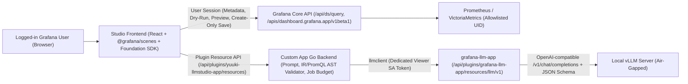

# LLM Dashboard Studio (`yuuki-llmstudio-app`)

An open-source, air-gap-ready Grafana App Plugin for generating, iteratively refining, previewing, and saving Prometheus/VictoriaMetrics dashboards using local LLMs via [`grafana-llm-app`](https://github.com/grafana/grafana-llm-app).

> **Status:** MVP (`0.1.0`) — Supports **Grafana OSS `13.3.1` (React 19)** and **Grafana OSS `12.4.15` (React 18)** (`grafanaDependency: ">=12.4.0 <14.0.0"`).

## Overview

LLM Dashboard Studio lets Grafana users describe what they want to observe in natural language (for example, *"Show request rate, 5xx error rate, and p95 latency for the selected service"*), grounds generation strictly in scoped metrics fetched from an allowlisted Prometheus-compatible datasource, and renders a live preview before saving.

Instead of letting an LLM author raw Grafana Dashboard JSON directly, the LLM produces a tightly constrained **Intermediate Representation (IR)** and **Patch** format. Deterministic validation, PromQL AST/regex safety checks, query execution, live previewing, and dashboard creation are controlled exclusively by the plugin and Grafana.

### Key Features

- **100% OSS & Air-Gap Ready:** No Grafana Cloud, Grafana Assistant, external LLM APIs, or external CDNs at runtime.
- **Unified LLM Routing (`grafana-llm-app`):** All inference traffic flows through Grafana's plugin resource API to `grafana-llm-app` and then to a local OpenAI-compatible inference server (vLLM primary target). No direct LLM bypass or duplicate proxy is added.
- **Metric-Grounded Generation & Partial Edits:** Fetches scoped metric catalogs (`service` / `job` / `namespace`) in browser memory, narrows candidates with BM25, generates initial drafts, supports targeted panel edits (`patch`), undo, and bounded syntax-only repair.
- **Split-Pane Studio UI:**
  - **Left pane:** Datasource/scope selection, chat input, job status, structural diff, dry-run validation results, folder picker, and save/export actions.
  - **Right pane:** Live `@grafana/scenes` preview (auto-refresh disabled; mounted explicitly after dry-run validation passes), IR JSON inspector, and Foundation SDK JSON inspector.
- **Preview-to-Save Parity:** A single normalization layer (`NormalizedDashboardSpec`) feeds both `@grafana/scenes` (preview) and `@grafana/grafana-foundation-sdk` (saved/exported Classic Dashboard JSON).
- **Create-Only Dashboard Saving:** Uses Grafana's Kubernetes-style Dashboard API (`POST /apis/dashboard.grafana.app/v1beta1/...`) with freshly app-generated UIDs and in-flight locks; on `409 Conflict`, it never falls back to `PUT` or overwrites existing dashboards.

## Architecture



- **Data & Save Boundary:** Metadata discovery, bounded dry-run validation (`now-5m`, `maxDataPoints=10`, concurrency `<=2`), `@grafana/scenes` preview, and dashboard creation all execute from the frontend using the **logged-in user's Grafana session**.
- **LLM Control Plane:** The Go backend owns prompt construction, untrusted-input sanitization, strict IR & PromQL AST validation, per-user job isolation (via Grafana's trusted `PluginContext`), and retry/repair budgets. The LLM service account token is never reused for datasource queries or dashboard writes.

## Compatibility

This plugin intentionally pins and verifies concrete target versions rather than claiming blanket compatibility across all Grafana releases.

| Component | Supported / Pinned Version | Notes |
|---|---|---|
| **Grafana OSS** | **`13.3.1`** (React 19) / **`12.4.15`** (React 18) | `plugin.json` declares `>=12.4.0 <14.0.0`; `react/jsx-runtime` & `react/jsx-dev-runtime` externalized |
| **`grafana-llm-app`** | **`v1.2.0`** (Grafana 13.x) / **`v1.0.8`** (Grafana 12.4.x) | Unified LLM relay (`/resources/llm/v1/chat/completions`) |
| **Go `llmclient`** | `v0.20.0` (`go-openai v1.41.1`) | Official Go client for `grafana-llm-app` |
| **`@grafana/scenes`** | `9.3.0` | Supports React 18 & 19 (`^18.0.0 \|\| ^19.0.0`) and `@grafana/runtime >=12.4` |
| **`@grafana/grafana-foundation-sdk`** | `0.0.22` | Generates Classic Dashboard JSON (`schemaVersion: 42`) |
| **`grafana-plugin-sdk-go`** | `v0.278.0` | `ProtocolVersion = 2` (wire-compatible with Grafana 12.4.x and 13.x) |
| **Local Inference Server** | `vLLM >= v0.12.0` (primary) | OpenAI-compatible `response_format` (`json_schema`); model-agnostic via `base`/`large` mapping |
| **Build Toolchain** | Node.js `>=22.0.0`, Go `1.24.3` | Reproducible offline builds via `npm ci` + `go mod vendor` |

See [`docs/compatibility.md`](docs/compatibility.md) for the full source-verified matrix and adversarial evaluation of candidate open-weight models.

## Quick Start (Local Development)

The included Docker Compose stack launches Grafana OSS, Prometheus (with query guardrails), and a lightweight Python sample exporter emitting RED and resource metrics (`service="checkout-api"`), with the plugin pre-provisioned in explicit development mock mode.

### Prerequisites

- Node.js `>= 22.0.0` and npm
- Go `1.24.x`
- Docker & Docker Compose

### 1. Install dependencies & build the plugin

```bash
npm ci
go mod download
make verify
```

### 2. Start the local stack

```bash
cp deploy/.env.example deploy/.env
# Defaults to Grafana OSS 13.3.1 (React 19).
# To test against Grafana OSS 12.4.15 (React 18), run: GRAFANA_VERSION=12.4.15 docker compose ...
docker compose -f deploy/docker-compose.yml up -d
```

### 3. Try the Studio workflow

1. Open Grafana at `http://localhost:3000` (default dev credentials are in `deploy/.env`).
2. Navigate to **LLM Dashboard Studio** (`/a/yuuki-llmstudio-app`).
3. Select datasource **`Prometheus Main (prom-main)`**, enter scope `service = checkout-api`, and click **Fetch Scoped Metrics**.
4. Enter a prompt, generate a draft, click **Validate & Preview** (runs bounded dry-run queries before mounting Scenes), test a partial panel edit or undo, and save as a new dashboard or export the Foundation SDK JSON.

## Production & Air-Gapped Deployment

1. **Allowlist only this unsigned plugin ID** in `grafana.ini` (or via environment variables) and disable Grafana outbound calls:
   ```ini
   [plugins]
   allow_loading_unsigned_plugins = yuuki-llmstudio-app
   public_key_retrieval_disabled = true
   plugin_admin_enabled = false

   [analytics]
   reporting_enabled = false
   check_for_updates = false
   check_for_plugin_updates = false

   [news]
   news_feed_enabled = false

   [security]
   disable_gravatar = true

   [snapshots]
   external_enabled = false
   ```
2. **Install `grafana-llm-app` offline** (`v1.2.0` for Grafana 13.x or `v1.0.8` for Grafana 12.4.x) and configure it to point at your internal vLLM server (`provider: "custom"`, model mappings for `base` / `large`, TLS, and API key auth).
3. **Create a dedicated Grafana Service Account** with the minimum OSS basic role **`Viewer`** (never `Editor` or `Admin`) and store its token in **Plugin Configuration → `llmServiceAccountToken` (`secureJsonData`)**.
4. **Switch `llmMode` to `grafana-llm-app`** and remove development provisioning files (`deploy/grafana/provisioning/plugins/llm-studio-dev.yaml`). Production mode never silently falls back to mock mode.
5. **Enforce upstream query limits** on Prometheus (`--query.timeout`, `--query.max-concurrency`, `--query.max-samples`) or VictoriaMetrics (`-search.maxQueryDuration`, `-search.maxConcurrentRequests`, `-search.maxSeries`). Browser-side dry-run caps are UX guardrails, not a DoS boundary.

For complete offline image/plugin/model-revision bundling instructions, see [`docs/airgapped-deployment.md`](docs/airgapped-deployment.md).

## Configuration Reference

Configured via **Administration → Plugins → LLM Dashboard Studio** (`jsonData` / `secureJsonData`):

| Setting | Storage | Default | Bounds / Allowed Values | Description |
|---|---|---|---|---|
| `allowedDatasourceUids` | `jsonData` | `[]` | Prometheus-compatible UIDs | Allowlist of datasources selectable in Studio; LLMs cannot choose arbitrary UIDs |
| `llmMode` | `jsonData` | `"grafana-llm-app"` | `"grafana-llm-app"`, `"mock"` | Inference backend mode (`"mock"` requires `allowMockInDev: true`) |
| `allowMockInDev` | `jsonData` | `false` | `boolean` | Explicit opt-in for dev/test mock mode; normalized to `false` outside mock mode |
| `grafanaUrl` | `jsonData` | `"http://localhost:3000"` | Loopback or same-origin `AppURL` | Internal Grafana URL used by Go `llmclient` (HTTP redirects disabled) |
| `modelTier` | `jsonData` | `"base"` | `"base"`, `"large"` | Logical model tier mapped by `grafana-llm-app` |
| `reasoningEffort` | `jsonData` | `"low"` | `""`, `"low"`, `"medium"`, `"high"` | Controls reasoning token budget on reasoning-capable models |
| `llmServiceAccountToken` | `secureJsonData` | *(unset)* | Grafana SA token (`glsa_...`) | Encrypted token dedicated solely to calling `grafana-llm-app` |
| `maxPanels` | `jsonData` | `6` | `1..6` | Maximum panels per generated dashboard |
| `maxRepairAttempts` | `jsonData` | `2` | `0..2` | Maximum syntax-only auto-repair calls per job (`0` disables repair) |
| `maxOutputTokens` | `jsonData` | `2048` | `256..8192` | `max_completion_tokens` cap per LLM call |
| `llmTimeoutSeconds` | `jsonData` | `45` | `5..120` | Per-attempt LLM request timeout |
| `jobDeadlineSeconds` | `jsonData` | `90` | `10..180` | End-to-end deadline per generation/patch/repair job |
| `maxConcurrentJobs` | `jsonData` | `4` | `1..16` | Global concurrent LLM job cap (per-user cap is `1`) |
| `validationTimeoutSeconds` | `jsonData` | `10` | `2..30` | Per-panel dry-run query timeout |
| `maxConcurrentQueries` | `jsonData` | `2` | `1..4` | Concurrent dry-run query cap in the browser |

## Security & Trust Boundaries

- **Trusted Identity & Isolation:** Job ownership is bound to Grafana's server-supplied `PluginContext` (`OrgID` + `User.Login`). Browser-supplied IDs are never trusted for authorization.
- **No Cross-User Metadata Cache:** Metric names, `HELP` strings, and label values are kept strictly in browser memory per session and cleared on organization or datasource switch.
- **SSRF & Redirect Protection:** `grafanaUrl` is restricted to loopback addresses or the Grafana instance's own `AppURL` origin, and `llmclient` disables HTTP redirects.
- **Prompt Injection Defense-in-Depth:** User prompts, metric metadata, LLM outputs, and datasource errors are treated as untrusted input—sanitized, length-bounded, and checked against deterministic schemas, catalog allowlists, and PromQL AST/regex safety rules. Raw URLs, HTML, JavaScript, and arbitrary datasource UIDs are disallowed in the IR.
- **Multi-Tenancy Caveat (Grafana OSS):** Within a single Grafana OSS organization, folder permissions or UI hiding do **not** isolate Prometheus metric access. Serving users with different data-access scopes in production requires separate Grafana organizations paired with upstream credential, tenant, or authorization-proxy isolation (detailed in [`docs/architecture.md`](docs/architecture.md)).

## Development & Verification

```bash
# Run all checks: schema sync, typecheck, Jest tests, Go race tests, and builds
make verify
```

Individual commands:

```bash
npm run verify:schemas   # Bidirectional enum & string-only schema sync (JSON Schema <-> TS <-> Go)
npm run typecheck        # TypeScript strict type checking (tsc --noEmit)
npm run test:ci          # Jest unit, Scenes/Foundation parity, saver, and UI lifecycle tests
npm run build            # Production Webpack bundle (dist/module.js)
go vet ./pkg/...         # Go static analysis
go test -race ./pkg/...  # Go unit, PromQL AST, job isolation, and grafana-llm-app contract tests
make build-backend       # Linux amd64 Go plugin binary (dist/gpx_yuuki_llmstudio_app_linux_amd64)
```

### Repository Structure

```text
.
├── pkg/                    # Go backend plugin (IR, PromQL AST validator, prompt builder, llmclient, job manager, plugin handlers)
├── src/                    # TypeScript/React frontend (Studio UI, AppConfig, metadata/BM25, dry-run validator, Scenes & Foundation adapters, saver)
├── schemas/                # Canonical Dashboard IR & Patch JSON Schemas and sample payloads
├── scripts/                # Bidirectional schema sync verifier
├── deploy/                 # Local Docker Compose stack, Prometheus config, sample exporter, dev provisioning
└── docs/                   # Architecture, compatibility matrix, air-gapped deployment guide, and ADRs
```

## Known Limitations (MVP Scope)

- **Scope:** Single Grafana organization, Prometheus-compatible datasources only, `timeseries` and `stat` panels only, fixed grid layout, auto-refresh disabled, non-streaming LLM requests. (Loki, Tempo, ClickHouse, template variables, repeat panels, existing dashboard import, GitOps sync, and MCP/tool execution are out of scope for MVP.)
- **In-Memory Job State:** Draft jobs are stored in a single Go backend process and reset on Grafana restart.
- **`grafana-llm-app` JSON Schema Proxy Behavior:** `grafana-llm-app` (`v1.0.8` / `v1.2.0`) unmarshals `response_format.json_schema.schema` into `go-openai/jsonschema.Definition`, which strips numeric/length/regex keywords and `extra_body`. Structure, `additionalProperties: false`, and string enums are enforced via vLLM structured outputs, while bounds, regexes, PromQL AST rules, and catalog membership are deterministically re-enforced in the Go backend.
- **Verification Coverage:** Automated unit tests, Scenes/Foundation parity tests, `grafana-llm-app` HTTP contract tests, and `@grafana/react-detect` static checks are verified locally. Live browser E2E against running Grafana (`13.3.1` / `12.4.15`) containers and GPU-backed vLLM instances should be validated in your target environment before production rollout.

## Documentation & ADRs

- [Architecture, Auth Boundaries & MVP Scope](docs/architecture.md)
- [Version Compatibility Matrix & Model Verification](docs/compatibility.md)
- [Air-Gapped Deployment & Upstream Guardrails Guide](docs/airgapped-deployment.md)
- Architecture Decision Records:
  - [ADR-001: Unified LLM Routing via `grafana-llm-app` & Structured Output Constraints](docs/adr/ADR-001-llm-routing-via-grafana-llm-app.md)
  - [ADR-002: Auth Boundaries & Grafana OSS RBAC Scope](docs/adr/ADR-002-auth-boundaries-and-oss-rbac.md)
  - [ADR-003: Lightweight IR, Dual Adapters & Create-Only Save API](docs/adr/ADR-003-ir-and-dual-adapters.md)
  - [ADR-004: Non-Streaming MVP & SSE Deferral](docs/adr/ADR-004-non-streaming-mvp-and-sse-deferral.md)
- Canonical Schemas:
  - [`schemas/dashboard-ir.schema.json`](schemas/dashboard-ir.schema.json)
  - [`schemas/dashboard-patch.schema.json`](schemas/dashboard-patch.schema.json)

## License

Licensed under the [Apache License, Version 2.0](LICENSE).
