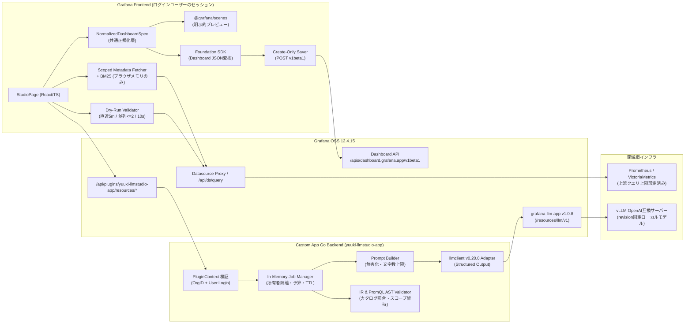
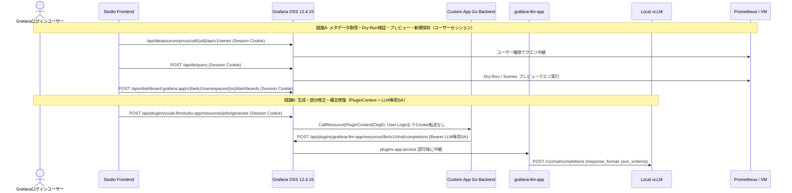

# アーキテクチャ設計（LLM Dashboard Studio MVP）

## 1. 全体構成とデータフロー

## 2. コンポーネント責務の分離

| コンポーネント | 責務 | 禁止事項・境界 |
|---|---|---|
| **Frontend (`src/`)** | スコープ限定メタデータ取得、BM25候補絞込み（メモリ内のみ）、Dry-Run検証クエリ実行、共通 `NormalizedDashboardSpec` 正規化、`@grafana/scenes` プレビュー、Foundation SDK 変換、新規保存・JSONエクスポート | LLM直結、他ユーザーとのメタデータ共有、未検証JSONの逐次プレビュー、既存ダッシュボードへの自動上書き |
| **Custom App Go Backend (`pkg/`)** | `PluginContext` に基づく呼び出し元識別、所有者隔離されたジョブ管理・全体予算管理・キャンセル、プロンプト構築・サニタイズ、IR JSON Schema・PromQL AST・カタログ照合・スコープ維持の決定的検査、部分修正パッチ適用・Diff/Undo | ユーザーSession Cookieへの依存、LLM用SAトークンのデータ取得・保存への流用、ローカルLLMへの直結、実LLM障害時の暗黙モックフォールバック |
| **`grafana-llm-app`** | LLM接続先URL・資格情報・モデル名対応付け (`base`/`large` -> 推論モデル名)・推論API中継 | 権限付与は最小化し、カスタムAppからの呼び出し経路を一本化 |
| **Prometheus / VictoriaMetrics** | 実メトリクス保持・クエリ評価、**DoS防御の最終境界**（クエリタイムアウト・同時実行数・最大系列数） | ブラウザ側の上限のみに依存しない |

## 3. 認証・認可経路（3経路の厳格な分離）

1. **データ取得・Dry-Run・プレビュー・保存**:
   - すべて Frontend からログインユーザーの Grafana セッションで実行する。
   - Grafana は App Plugin Backend へブラウザの Session Cookie を転送しない（公式仕様確認済み）。
   - `PluginContext.User`、識別用ヘッダー (`X-Grafana-User`)、サービスアカウントトークンをユーザー代理認証と同一視しない。
2. **Backend ジョブ操作の認可・所有者隔離**:
   - Backend は `backend.PluginConfigFromContext(ctx)` の `OrgID` と `User.Login` のみを信頼し、リクエスト本文の `orgId`/`userId` は受け付けない（`DisallowUnknownFields` で拒否）。
   - ジョブ参照・パッチ・修復・Undo・キャンセルはすべて `(OrgID, UserLogin)` の一致を検証し、別ユーザー・別Organizationからのアクセスは HTTP `403 Forbidden` とする。
3. **LLM 呼び出し認証（`llmclient` 用サービスアカウント）**:
   - `plugin.json` の `iam.permissions` は `{"action":"plugins.app:access","scope":"plugins:grafana-llm-app"}` のみを要求する。
   - Grafana OSS で手動作成するサービスアカウントを用いる場合、選択可能な最小基本ロールは `Viewer` である（OSS には Enterprise RBAC のカスタムロールがない）。
   - **重要な区別**: `Viewer` 基本ロールには `plugins.app:access` に加え、同一 Organization 内の読み取り・データソースクエリ権限も含まれる。「LLM 専用に使う」ことと「LLM 以外の権限を持たない」ことは異なるため、Go Backend コード上でこのトークンを `llmclient` 以外へ絶対に渡さない構造とする。

## 4. MVP 範囲とマルチテナント隔離設計（非対応境界の明示）

### 4.1 初期 MVP の適用範囲
- 同一のデータ閲覧権限を持つ利用者からなる **単一の Grafana Organization**。
- 管理者が App Config の `allowedDatasourceUids` で明示許可した **単一の Prometheus 互換データソース**。
- パネル種別は **`timeseries` と `stat` の2種**、固定グリッド配置、**自動 refresh 無効**。
- 新規ダッシュボード作成・ドラフト内部分修正・JSON エクスポートのみ。
- メタデータは選択スコープに絞って取得し、ブラウザメモリと単一リクエスト内のみで扱う（共有永続キャッシュなし）。
- ジョブ状態は単一 Backend プロセス内の TTL・上限付きメモリ管理（再起動で失効、複数 Grafana レプリカ間の継続処理は対象外）。

### 4.2 異なるデータ閲覧範囲を持つ利用者への提供要件（MVP対象外）
- Grafana OSS 12.4.15 の同一 Organization 内では、データソース単位の RBAC 権限設定・LBAC は Enterprise/Cloud 機能であり、Folder 権限や UI 上の非表示だけではメトリクス閲覧制限を実現できない。
- **したがって、本 MVP の制限は「利用者ごとのデータ権限分離」を満たしていない。**
- 異なる閲覧範囲を持つ利用者へ本番提供する場合は、以下が必須となる：
  1. Grafana Organization をテナント単位で分離する。
  2. 各 Organization のデータソース設定ごとに、上流の資格情報・テナントヘッダー (`X-Scope-OrgID` 等)・VictoriaMetrics `vmauth` 等の認可プロキシで実データを物理/論理隔離する。
  3. サーバー側メタデータキャッシュを導入する場合は、`(orgId, tenantScope, datasourceUid)` 単位の厳格なキー分離と認可検証を組み込む。

### 4.3 初期フェーズで実装しない機能（将来の拡張点）
- Loki / Tempo / ClickHouse データソース対応（IR の `query` 種別とデータソース別 AST バリデータ追加で拡張可能）
- 複雑なテンプレート変数・Repeat Panel・既存任意 Dashboard JSON の完全取り込み
- GitOps 自動反映・MCP・任意ツール実行・ベクトルDB・汎用エージェントフレームワーク・分散ジョブ基盤（Redis/DB 永続化によるマルチレプリカ対応は `pkg/jobs` のストレージ抽象化で将来対応可能）

## 5. ブラウザ状態のクリア方針
- **ログアウト / 画面アンマウント**: React state のメタデータ・ドラフト・プレビューを破棄し、進行中の HTTP リクエストを `unsubscribe` / `AbortController` で中断する。
- **Organization 変更 / データソース変更**: `StudioPage` は `${orgId}:${selectedDatasourceUid}` の変化を検知し、即座にメタデータカタログ・ジョブ状態・検証結果・Scenes プレビューを完全リセットする。
