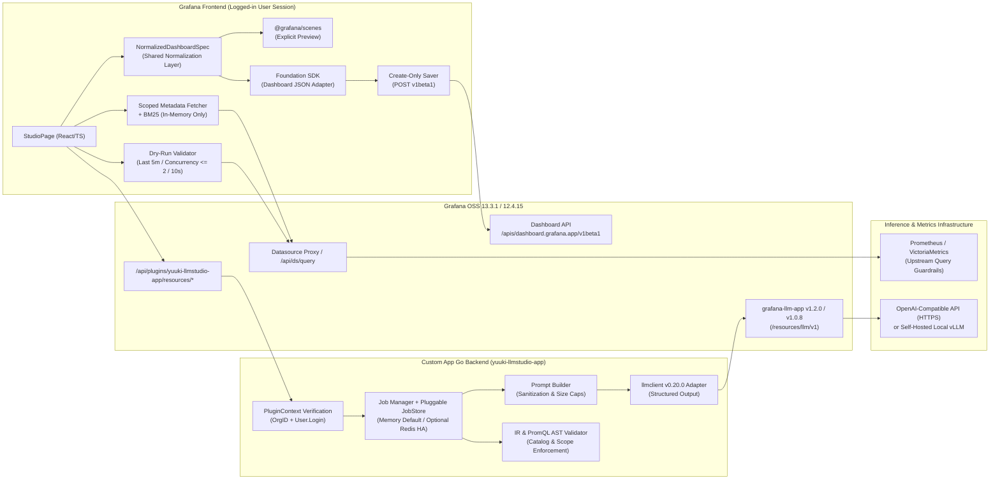
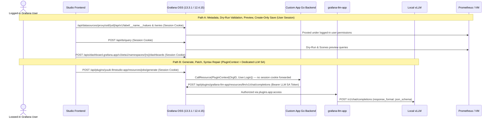

# Architecture Design (LLM Dashboard Studio MVP)

## 1. System Overview & Data Flow

## 2. Separation of Responsibilities

| Component | Responsibilities | Prohibitions & Boundaries |
|---|---|---|
| **Frontend (`src/`)** | Scoped metadata discovery, in-memory BM25 candidate narrowing, bounded dry-run validation queries, shared `NormalizedDashboardSpec` normalization, `@grafana/scenes` live preview, Foundation SDK conversion, create-only dashboard saving, JSON export | Direct calls to LLM servers, sharing metadata across users, streaming/incremental preview of unvalidated JSON, automatic overwrite of existing dashboards |
| **Custom App Go Backend (`pkg/`)** | Caller identification via `PluginContext`, owner-isolated job lifecycle, concurrency & repair budgets, cancellation, prompt construction & sanitization, deterministic validation (IR JSON Schema, PromQL AST/regex, catalog membership, scope preservation), targeted patching, diff & undo | Relying on browser session cookies, reusing the LLM service account token for datasource queries or dashboard writes, direct LLM connections, silent fallback to mock mode on real LLM failure |
| **`grafana-llm-app`** | LLM endpoint URL, provider credentials, logical model mapping (`base`/`large` -> served model name), inference API relay | Minimal permissions; single unified LLM routing path for the custom app |
| **Prometheus / VictoriaMetrics** | Metric storage, query evaluation, and the **final DoS defense boundary** (query timeout, max concurrency, max samples/series) | Never rely solely on browser-side query caps |

## 3. Authentication & Authorization (Strict Separation of Pathways)

1. **Data Access, Dry-Run, Preview, and Dashboard Save:**
   - All executed from the frontend using the logged-in user's Grafana session.
   - Grafana does **not** forward browser session cookies to App Plugin backends (verified against official documentation and SDK behavior).
   - `PluginContext.User`, identity headers (`X-Grafana-User`), and service account tokens are never treated as user-impersonated authentication.
2. **Backend Job Authorization & Owner Isolation:**
   - The backend trusts only `OrgID` and `User.Login` from `backend.PluginConfigFromContext(ctx)`. Any `orgId` or `userId` in request payloads is rejected (`DisallowUnknownFields`).
   - Reading, patching, repairing, undoing, or cancelling a job verifies an exact `(OrgID, UserLogin)` owner match; cross-user or cross-organization access returns HTTP `403 Forbidden`.
3. **LLM Inference Authentication (`llmclient` Service Account):**
   - `plugin.json` `iam.permissions` requests only `{"action":"plugins.app:access","scope":"plugins:grafana-llm-app"}`.
   - When manually creating a service account in Grafana OSS, the minimum available basic role is `Viewer` (custom RBAC roles are a Grafana Enterprise/Cloud feature).
   - **Important distinction:** In Grafana OSS, the `Viewer` basic role grants organization-wide read/query access in addition to `plugins.app:access`. *"Using a token exclusively for LLM calls"* is not the same as *"having no non-LLM permissions."* The Go backend enforces this boundary structurally by never passing the token anywhere outside `llmclient`, strictly pinning `grafanaUrl` to Grafana's trusted `AppURL` base URL (or operator-pinned `LLMSTUDIO_GRAFANA_URL`, falling back to loopback only when neither is present), binding stored UI secrets to their destination, and disabling HTTP redirects.

## 4. MVP Scope & Multi-Tenant Isolation Boundaries

### 4.1 Initial MVP Scope
- A **single Grafana organization** whose users share the same data-access scope.
- A **single admin-allowlisted Prometheus-compatible datasource** (configured via `allowedDatasourceUids`).
- Two panel types only (**`timeseries`** and **`stat`**), fixed grid layout, and **auto-refresh disabled**.
- Create-only dashboard saving, in-draft partial panel edits, and clean JSON export.
- Scoped metadata fetched per session in browser memory and single-request scope only (no shared persistent metadata index).
- Pluggable `JobStore` in `pkg/jobs`: defaults to a zero-dependency process-local in-memory store (`jobStoreBackend: "memory"`), with an optional persistent Redis/Valkey backend (`jobStoreBackend: "redis"`) for HA multi-replica Grafana deployments enforcing atomic `(OrgID, UserLogin)` owner isolation, lease-based per-user/global concurrency limits, atomic repair-budget accounting, fencing tokens for `Undo`/`Cancel`, and native TTL expiration.

### 4.2 Serving Users with Different Data-Access Scopes (Out of Scope for MVP)
- Within a single Grafana OSS organization (`12.4.15` / `13.3.1`), datasource-level RBAC and LBAC are Enterprise/Cloud features. Folder permissions and UI hiding do **not** restrict Prometheus metric access.
- **Accordingly, the MVP's single-organization restriction does not satisfy per-user data isolation.**
- To serve users with distinct data-access scopes in production, you **must**:
  1. Separate tenants into distinct Grafana organizations.
  2. Enforce physical or logical data isolation per organization datasource using upstream credentials, tenant headers (for example, `X-Scope-OrgID`), or an authorization proxy such as VictoriaMetrics `vmauth`.
  3. If a server-side metadata cache is introduced in the future, key and authorize every cache entry strictly by `(orgId, tenantScope, datasourceUid)`.

### 4.3 Deferred Features (Future Extension Points)
- Additional datasources (Loki, Tempo, ClickHouse) — extensible by adding query kinds to the IR and per-datasource AST validators.
- Complex template variables, repeat panels, and full import of arbitrary existing Dashboard JSON.
- Automated GitOps sync, MCP, arbitrary tool execution, vector databases, and general-purpose agent frameworks.

## 5. Browser State Clearing Policy
- **Logout / Page Unmount:** React state holding metric catalogs, drafts, validation results, and Scenes previews is discarded, and in-flight HTTP requests are cancelled via RxJS `unsubscribe` / `AbortController`.
- **Organization or Datasource Switch:** `StudioPage` monitors `${orgId}:${selectedDatasourceUid}` and immediately aborts active requests and resets the in-memory catalog, job state, validation results, and Scenes preview on any change.
