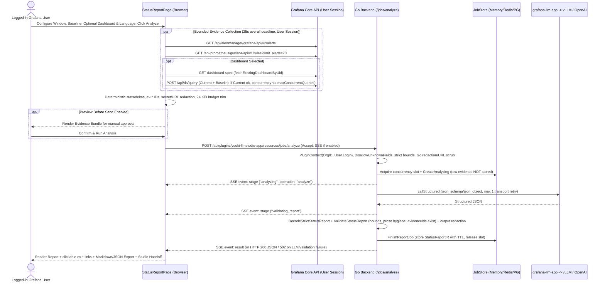

# Detailed Design & Implementation Plan: Operational Status & Incident Analysis Report

- **Related ADR:** [ADR-005: On-Demand Operational Status & Incident Analysis Report](adr/ADR-005-operational-status-report.md)
- **Status:** Accepted (2026-11-27; revised after adversarial design review)
- **Target Stack:** Grafana OSS `13.3.1` (React 19) & `12.4.15` (React 18), `grafana-llm-app` `v1.2.0` / `v1.0.8`, Prometheus & VictoriaMetrics

---

## 1. Goals & Scope Summary

### In Scope (Phase 1 / MVP)
1. **Dedicated Navigation Page (`/a/yuuki-llmstudio-app/reports`)** added via `src/plugin.json` `includes` (`role: "Viewer"`, `addToNav: true`; requires Grafana restart on upgrade).
2. **On-Demand Browser-Side Evidence Collection** (logged-in user session only):
   - **Grafana Unified Alerting**: Active/suppressed/unprocessed alerts (`/api/alertmanager/grafana/api/v2/alerts`) + alerting rule evaluation states (`/api/prometheus/grafana/api/v1/rules?limit_alerts=20`, filtering `type === "alerting"` and capturing `firing`, `recovering`, `pending`, `error`, `nodata`, `unknown`).
   - **Dashboard-Anchored Performance Metrics (Optional)**: Selected saved Grafana dashboard panels extracted via a dedicated read-only extractor (`src/report/dashboardExtractor.ts`, supporting `$__rate_interval`/`$__interval`/`$__range`, default `null` datasource, and `${DS_*}` variables) and queried over a bounded analysis window (`15m`, `1h`, `6h`, `24h`) with configurable baseline comparison (`preceding` [default], `24h_ago`, or `none`).
   - Works in **Alerts-only mode** (including healthy clusters with 0 firing alerts) or **Dashboard + Alerts mode**.
3. **Defense-in-Depth Privacy & Transparency UX**:
   - Default 1-click flow (`Collect -> Client-side Secret/URL Redaction -> Analyze`), showing all collected evidence in the left pane with clickable `ev-*` evidence links.
   - Opt-in **"Preview evidence before sending"** checkbox for manual two-step approval.
   - Identical server-side redaction & URL scrubbing in Go (`pkg/prompt/report_redact.go`) before LLM invocation and before persisting validated output.
4. **Compact Grounded `StatusReportIR` & Fail-Closed Go Validation**:
   - Canonical schema `schemas/status-report.schema.json` (`go-openai` compatible, synced via `scripts/verify-schema-sync.mjs`, wire-verified via `make verify-llm-protocol`).
   - Mandatory `evidenceIds` grounding checked deterministically by Go across `ev-alert-*`, `ev-rule-*`, `ev-metric-*`, `ev-warn-*`, and `ev-status-*`; hallucinated IDs, duplicate IDs, missing required arrays, or schema violations fail closed (`502`, zero auto-repair loops, zero silent stripping).
   - Selectable report language (`ja` / `en`, defaulting to active Grafana locale).
5. **Safe Studio Handoff & Export**:
   - Plain-text `suggestedInvestigationIntent` with **"Investigate in Studio"** navigation via `locationService` to `/a/yuuki-llmstudio-app` (no raw unvalidated PromQL in reports; datasource/scope derived strictly from user-selected request context).
   - Deterministic client-side **Markdown** (localized via `LOCALE_RESOURCES[reportLanguage]`, Markdown-escaped, with non-HTTPS clipboard fallback) and **JSON** export.
6. **Zero New Admin Settings Keys & Compatible HA JobStore**:
   - Reuses existing `jsonData` bounds (`allowedDatasourceUids`, `maxConcurrentQueries`, `validationTimeoutSeconds`, `maxOutputTokens`, `llmTimeoutSeconds`, `jobDeadlineSeconds`, `maxConcurrentJobs`, `enableSseProgress`, `jobTtlMinutes`).
   - Safe Redis rolling-upgrade fields (`job_kind`, `report_json`) and DML-only-safe PostgreSQL column probe (`job_kind` + `report_json`).

### Out of Scope (Deferred)
- **Phase 2:** Scope-only 2-step AI query planning (without selecting a dashboard), Prometheus/VictoriaMetrics datasource-managed alerts (`/api/v1/alerts`), alert state transition & deploy annotations (`/api/annotations`), bounded follow-up Q&A.
- **Phase 3:** Loki (error log summaries) and Tempo (latency trace summaries) evidence adapters.
- **Explicit Non-Goal:** Background scheduled reports / Cron / Slack delivery (conflicts with ADR-002).

---

## 2. End-to-End Flow



---

## 3. Frontend Evidence Collection & Summarization (`src/report/`)

### 3.1 Grafana Unified Alerting Collector (`src/report/alertsCollector.ts`)
Uses `getBackendSrv()` under the logged-in user's session with explicit per-request timeout (`8s`) and `AbortSignal`:
1. **`GET /api/alertmanager/grafana/api/v2/alerts?active=true&silenced=true&inhibited=true&unprocessed=true`**
   - Extracts up to `MAX_ALERT_EVIDENCE = 25` alerts sorted by priority:
     1. Scope-matching active `critical`/`page`/`error` alerts
     2. Other active `critical`/`page`/`error` alerts (if "Include org-wide critical alerts" is enabled, default `true`)
     3. Active `warning`/other alerts
     4. Suppressed/unprocessed alerts
     5. Most recent `startsAt` first
   - Assigns deterministic IDs `ev-alert-1` .. `ev-alert-N`.
   - Captures: `id`, `alertName` (falling back to `labels.rulename` when `alertname` is `DatasourceNoData`/`DatasourceError`), `state` (`active` | `suppressed` | `unprocessed`), `severity`, `startsAt` (RFC3339), `labels` (capped at 10 pairs, prioritizing `alertname`, `rulename`, `severity`, `priority`, `service`, `job`, `namespace`, `instance`, `pod`, `grafana_folder`), `summary` (falling back to `annotations.message`), `description`, `matchesScope`.
2. **`GET /api/prometheus/grafana/api/v1/rules?limit_alerts=20`**
   - Filters strictly to `rule.type === 'alerting'` (skips recording rules).
   - Tracks `totalRulesEvaluated` across all alerting rules.
   - Extracts abnormal rules (`state` in `firing`/`recovering`/`pending` OR `health` in `error`/`nodata`/`unknown`) up to `MAX_RULE_EVIDENCE = 20`.
   - **Deduplication / External Alertmanager Support:** Cross-references firing rules against `/v2/alerts` via `__alert_rule_uid__` / `rulename`; suppresses duplicate firing-only rule entries already covered by an `ev-alert-*` (preserving rules that have `health` errors/`nodata`/`pending`/`recovering` or that are absent from `/v2/alerts` due to an external Alertmanager).
   - Scope matching inspects both `rule.labels` and `rule.alerts[].labels`.
   - Assigns deterministic IDs `ev-rule-1` .. `ev-rule-N`.
3. **Healthy-Cluster Summary & Graceful Degradation:**
   - Records `collectionStatus: { alertsChecked, rulesChecked, totalRulesEvaluated, activeAlertsTotal, abnormalRulesTotal }`.
   - HTTP `403` -> warning `ev-warn-*` (`code: "alerting_forbidden"`), HTTP `404`/`501`/timeout -> warning `ev-warn-*` (`code: "alerting_unavailable"`), truncation -> warning `ev-warn-*` (`code: "evidence_truncated"`).
   - When alerting succeeded with 0 firing alerts, 0 abnormal rules, and no metric anomalies, emits a deterministic status item `ev-status-1` (`"Grafana Alerting checked: 0 active alerts across N rules"`) so even an LLM-analyzed healthy check has a valid, concrete evidence ID to cite.

### 3.2 Read-Only Dashboard Query Extractor (`src/report/dashboardExtractor.ts`)
Instead of reusing `convertGrafanaDashboardToIR`, extracts queries directly from the fetched raw dashboard (`fetchExistingDashboardByUid`):
- **Supported Variables & Built-ins:** Allows Grafana built-in time variables (`$__rate_interval`, `$__interval`, `$__interval_ms`, `$__range`, `$__range_s`, `$__range_ms`) to pass through untouched to `/api/ds/query` (with computed `intervalMs`). Interpolates user-selected `scope` into matching dashboard template variables (`$service`, `$job`, `$namespace`) or uses concrete current/default values; skips targets with unresolved non-builtin variables and records a `collectionWarning`.
- **Datasource Resolution & Strict Allowlist Check:** Resolves `null`/omitted datasource via `getDataSourceSrv().getInstanceSettings(null)` and `${DS_*}`/`$datasource` template variables to the user's selected allowlisted datasource. Every query target's resolved UID MUST be in `publicConfig.allowedDatasourceUids` and Prometheus/VictoriaMetrics-compatible; otherwise skipped with warning.
- **Panel Selection & Cap:** Extracts up to `REPORT_MAX_PANELS = 8` panels (independent of IR's `MaxPanelsHardCap = 6`), prioritizing panels with configured thresholds or alerting/error/latency titles (and allowing the user to inspect skipped panel count). Never throws on 0 compatible panels — records a warning and lets alerts-only analysis proceed.
- **Raw Threshold Preservation:** Extracts raw Grafana panel `fieldConfig.defaults.thresholds` (`mode`, `steps` including the `value: null` base step and red/orange/yellow color families) directly for accurate threshold breach evaluation.

### 3.3 Bounded Metric Summarizer (`src/report/metricsCollector.ts`)
- **Overall Deadline & Load Guardrails:** Enforces an overall `25s` collection deadline (`AbortController`), worker pool `concurrency <= publicConfig.maxConcurrentQueries` (1..4), and per-query timeout `<= publicConfig.validationTimeoutSeconds` (2..30s). If a panel's current-window query fails or times out, **skips the baseline query** for that panel to avoid hammering an unhealthy Prometheus.
- **Window & Step Alignment:**
  - Windows: `15m` (`intervalMs: 15_000`), `1h` (`intervalMs: 60_000`), `6h` (`intervalMs: 300_000`), `24h` (`intervalMs: 900_000`) — keeping ~60–96 points per series while remaining compatible with `rate(...[$__rate_interval])`.
  - Baseline: `preceding` (`[fromMs - duration, fromMs]`), `24h_ago` (`[fromMs - 24h, toMs - 24h]`), or `none`.
  - `/api/ds/query` passes string epoch ms (`String(fromMs)`, `String(toMs)`), explicit `intervalMs`, `maxDataPoints: 100`.
- **DataFrame Parsing & Robust Math (`ev-metric-1` .. `ev-metric-N`, max `MAX_METRIC_EVIDENCE = 20`):**
  - Parses both long and wide Grafana DataFrames via `frame.schema.fields` (`type === 'time'` + numeric value fields with `field.labels` / `field.name`).
  - Filters strictly with `Number.isFinite(v)` (ignoring `null`, `NaN`, `±Infinity`, string `"NaN"`).
  - Matches current vs. baseline series by canonical sorted `key=value` label fingerprint.
  - Selects up to 3 series per panel ranked by **anomaly score** (threshold breach > `abs(deltaPct)` > inverted/zero-drop detection for `up`/availability/ratio metrics > max extremity).
  - Computes:
    - `latest`, `avg`, `p95`, `min`, `max`, `sampleCount`, `missingRatio` (against expected step count `Math.floor(windowMs / stepMs) + 1`, clamped `0..1`), `peakAt` (RFC3339).
    - `deltaPctAvg` / `deltaPctP95`: uses `Math.abs(baseline)` denominator; when `Math.abs(baseline) < 1e-6`, omits `deltaPct*` and sets `baselineWasZero: true`.
    - `thresholdBreached`: evaluates both `latest` and worst extremum (`max`, or `min` when thresholds are inverted such as `null -> red, 1 -> green`) against raw panel threshold steps (`absolute` mode; skips `percentage` mode cleanly).

### 3.4 Defense-in-Depth Secret Redaction & URL Scrubbing (`src/report/redact.ts` & `pkg/prompt/report_redact.go`)
Implemented identically in TypeScript (browser preview/transmission) and Go (pre-prompt & pre-persistence):
- Redacts:
  - `Authorization: Bearer ...` / `Basic ...` / `Cookie: ...`
  - Grafana tokens (`glsa_...`, `glc_...`), GitHub (`ghp_...`, `gho_...`, `github_pat_...`), Slack (`xox[baprs]-...`), AWS (`AKIA[0-9A-Z]{16}`), OpenAI-style (`sk-(?:proj-)?[A-Za-z0-9]{20,}`)
  - 3-segment JWTs (`eyJ[A-Za-z0-9_-]{10,}\.eyJ[A-Za-z0-9_-]{10,}\.[A-Za-z0-9_-]{10,}`)
  - PEM private key blocks (`-----BEGIN ... PRIVATE KEY-----`)
  - Credentialed URIs (`(?:https?|postgres(?:ql)?|redis|rediss|mysql|mongodb|amqp)://[^:\s/@]+:[^@\s/]+@`)
  - Query-string & JSON key-value secrets (`(token|password|passwd|api_?key|access_key|client_secret|x-amz-signature)` with `=` or `":"`, while avoiding redacting short Kubernetes label names like `secret=tls-cert-prod` in label maps)
- Scrubs remaining `https?://[^\s"'<>]+` URLs to `[URL]` so upstream Alerting error messages (e.g., `Get "http://prometheus:9090/..."`) cannot be echoed by the LLM and trigger fail-closed output rejection.
- Frontend enforces the unified **`24 KiB` (`24 * 1024` UTF-8 bytes)** evidence payload budget via deterministic priority trimming before Preview/POST, adding `ev-warn-*` (`evidence_truncated`) when trimmed.

---

## 4. Canonical Contracts & Schema Validation

### 4.1 Request Contract: `POST /jobs/analyze`
Decoded with `DisallowUnknownFields`, bounded by `maxRequestBodyBytes` (`256 KiB`) with a strict post-sanitization evidence payload cap of **`MaxAnalyzePayloadBytes = 24 * 1024`** (matching `pkg/prompt.MaxFinalPayloadBytes`, leaving ample headroom for embedded schemas in `json_object` mode on 16k-context vLLM models).

```ts
export type ReportWindow = '15m' | '1h' | '6h' | '24h';
export type BaselineMode = 'preceding' | '24h_ago' | 'none';
export type ReportLanguage = 'en' | 'ja';

export interface AnalyzeStatusRequest {
  datasourceUid?: string; // REQUIRED and allowlist-checked whenever evidence.metrics.length > 0 || dashboardContext != null
  scope?: ScopeFilter;    // Validated explicitly regardless of datasourceUid
  window: ReportWindow;
  baselineMode: BaselineMode;
  language: ReportLanguage;
  userFocus?: string;     // Optional operator focus prompt (max 300 runes)
  dashboardContext?: {
    uid?: string;
    title: string;
    panelCount: number;
    analyzedPanelCount: number;
  };
  collectionStatus: {
    alertsChecked: boolean;
    rulesChecked: boolean;
    totalRulesEvaluated: number;
    activeAlertsTotal: number;
    abnormalRulesTotal: number;
  };
  evidence: {
    collectedAt: string; // RFC3339 (validated in Go)
    alerts: AlertEvidenceItem[];   // max 25
    rules: RuleEvidenceItem[];     // max 20
    metrics: MetricEvidenceItem[]; // max 20
    statusNotes?: StatusNoteEvidenceItem[]; // max 4 (ev-status-1..4)
  };
  collectionWarnings?: CollectionWarningItem[]; // max 12 (ev-warn-1..12)
}
```

**Pre-flight Validation (Go Backend — strictly typed structs, no `map[string]any`):**
1. If `len(evidence.metrics) > 0 || dashboardContext != nil`: require `datasourceUid != ""` and membership in `AllowedDatasourceUIDs` (`403 ErrDatasourceDenied`). If `datasourceUid != ""`, always verify allowlist membership.
2. Validate `scope` explicitly when present (`^[a-zA-Z_][a-zA-Z0-9_]{0,63}$`, `!= "__name__"`, non-empty bounded value).
3. Reject with `422 ErrInsufficientEvidence` **only** when zero sources succeeded (`!alertsChecked && !rulesChecked && len(metrics) == 0`).
4. Validate all enums (`window`, `baselineMode`, `language`, alert/rule/metric states & healths, warning codes), RFC3339 timestamps (`collectedAt`, `startsAt`, `peakAt`), finite floats (`!math.IsNaN && !math.IsInf`, `missingRatio` in `0..1`), unique valid evidence IDs (`^ev-(alert|rule|metric|warn|status)-[1-9][0-9]{0,2}$`), and per-field rune/array bounds.
5. Run `pkg/prompt/report_redact.go` (secret redaction + URL scrubbing + `SanitizeUntrustedText`) on all untrusted strings and verify serialized evidence JSON `<= 24 KiB`.

### 4.2 Output Contract: `schemas/status-report.schema.json`
100% compatible with `grafana-llm-app` `v1.0.8` & `v1.2.0` (`go-openai/jsonschema.Definition`):
- String-only `enum`s, **no `oneOf`/`anyOf`/`const`/`format`**, no array `type`, `additionalProperties: false` everywhere, `Strict: false`.
- Compact bounds designed to stay well inside `maxOutputTokens: 2048` (recommend `>= 4096` for Japanese or reasoning models):

| Field | Type / Enum | Bounds (re-checked in Go) | Description |
|---|---|---|---|
| `schemaVersion` | `"1.0"` | enum `["1.0"]` | Report IR schema version |
| `overallStatus` | `"healthy" \| "degraded" \| "critical" \| "insufficient_data"` | enum | Overall operational assessment |
| `confidence` | `"high" \| "medium" \| "low"` | enum | Assessment confidence |
| `executiveSummary` | `string` | `1..400` runes | Concise single-line plain-text summary in requested language |
| `timeline` | `array` | `0..8` items | `{ timestamp (1..40), event (1..160), evidenceIds (1..6 unique) }` |
| `findings` | `array` | `0..6` items | `{ id (^f-[1-9][0-9]?$), category ("alert" \| "performance" \| "incident" \| "monitoring_gap"), severity ("critical" \| "warning" \| "info"), title (1..100), detail (1..350), evidenceIds (1..6 unique) }` |
| `hypotheses` | `array` | `0..3` items | `{ title (1..100), likelihood ("high" \| "medium" \| "low"), rationale (1..300), evidenceIds (1..6 unique), verificationSteps (0..3 strings, 1..140 each) }` |
| `recommendedActions` | `array` | `0..5` items | `{ priority ("immediate" \| "short_term" \| "follow_up"), action (1..200), relatedFindingIds (0..4 unique) }` |
| `dataGaps` | `array` | `0..6` strings (`1..160`) | Blind spots or uncollected telemetry |
| `suggestedInvestigationIntent` | `string` (optional) | `0..250` runes | Plain-text prompt suggestion for Dashboard Studio handoff (no raw PromQL) |

### 4.3 Deterministic Fail-Closed Go Validation (`pkg/ir/report_validate.go`)
1. `DecodeStrictStatusReport`: `DisallowUnknownFields`, single JSON object, `<= 24 KiB`, plus `rawStatusReportRequiredCheck` ensuring required keys (`timeline`, `findings`, `hypotheses`, `recommendedActions`, `dataGaps`) are explicitly present (not omitted under `Strict: false` / `json_object`).
2. `ValidateStatusReport(report, allowedEvidenceIDs)`:
   - Re-enforces all enum values, rune limits, array limits, and `findings[].id` regex + uniqueness.
   - Enforces every `evidenceIds` array has `>= 1` unique ID and every ID exists in `allowedEvidenceIDs` (which includes `ev-alert-*`, `ev-rule-*`, `ev-metric-*`, `ev-warn-*`, `ev-status-*`).
   - Enforces `len(findings) >= 1` whenever `overallStatus` is `"degraded"` or `"critical"`.
   - Enforces every `relatedFindingIds` entry is unique and exists in `findings[].id`.
   - Enforces prose-safe hygiene: rejects HTML tags (`(?i)<\s*/?\s*[a-z][a-z0-9-]*[\s/>]`), `http://`, `https://`, `javascript:`, `vbscript:`, `data:`, and control characters — without rejecting benign `<` / `>` inequality comparisons.
   - Runs Go secret redactor on output fields before persisting to `JobStore`.

---

## 5. Backend Architecture, Error Semantics & HA Storage

### 5.1 Routes & Standardized Error Contract (`pkg/plugin/app.go`)
- **`POST /jobs/analyze`**:
  - Extracts `Owner{OrgID, UserLogin}` exclusively from `backend.PluginConfigFromContext(ctx)`.
  - Pre-flight failures (before SSE headers are written): `400` (malformed JSON/fields), `401` (unauthenticated), `403` (`ErrDatasourceDenied`), `422` (`ErrInsufficientEvidence`), `429` (`ErrConcurrencyLimited`), `503` (`ErrStoreUnavailable` / `ErrReportStorageMigrationRequired`).
  - Post-flight failures (LLM or validation failure after job creation): Job transitions to `StatusFailed` (persisted without raw evidence), slot is released, and the handler returns HTTP `502 Bad Gateway` (or SSE `event: error` with status `502` and `jobId`). `ErrJobCancelled` returns `409 Conflict`.
  - SSE support (`enableSseProgress: true` + `Accept: text/event-stream`): emits `operation: "analyze"`, stages `analyzing` -> `validating_report` -> terminal `ready`/`failed`/`cancelled`, followed by `event: result` or `event: error`.
- **`GET /jobs/{id}`** & **`POST /jobs/{id}/cancel`**: reused with `(OrgID, UserLogin)` isolation.
- **`POST /jobs/{id}/patch`**, `/repair`, `/undo`: return `409 Conflict` (`jobs.ErrWrongJobKind`) when called on a `job_kind == "report"` job across all 3 stores.

### 5.2 `pkg/llm.Client` & `pkg/prompt`
- Add `AnalyzeStatus(ctx context.Context, req AnalyzeStatusRequest) ([]byte, CompletionMeta, error)` to `pkg/llm.Client`.
- `GrafanaLLMClient.AnalyzeStatus` uses the existing `callStructured` helper (`pkg/llm/grafana_llm.go:144`) with `schemas.StatusReportSchemaJSON`, `max 1` transport retry, zero semantic repair.
- `MockClient.AnalyzeStatus` returns a deterministic, grounded `StatusReportIR` citing actual `ev-*` IDs from `req`, honoring `req.Language` (`ja` / `en`) and `Delay`.
- All backend status/error messages for `AnalyzeStatus` use clean English/structured messages (never hardcoded Japanese strings when `language: "en"`).

### 5.3 `pkg/jobs` & Storage Compatibility
Additive `JobSnapshot` fields (`omitempty`):
```go
JobKind      string             `json:"jobKind,omitempty"`      // "" / "dashboard" | "report"
StatusReport *ir.StatusReportIR `json:"statusReport,omitempty"`
```
New `JobStatus` constants: `StatusAnalyzing = "analyzing"`, `StatusValidatingReport = "validating_report"`.
New `Operation` constant in `pkg/jobs/progress.go`: `OperationAnalyze = "analyze"`.

**Critical Invariants Across `MemoryStore`, `RedisStore`, and `PostgresStore`:**
1. **`Cancel` safety:** When `job_kind == "report"` and `status` is already terminal (`ready`, `failed`, `cancelled`), `Cancel` is a no-op returning the existing snapshot.
2. **`queryKind` fidelity:** When `job_kind == "report"`, do **not** coerce empty `query_kind` to `"promql"`.
3. **`RedisStore`:** Additive optional hash fields `job_kind` and `report_json` (`current_ir_json` stays `""`). All Lua scripts access only declared `KEYS[]` under `{redisKeyPrefix}`.
4. **`PostgresStore`:**
   - Fresh `CREATE TABLE IF NOT EXISTS` includes `job_kind TEXT NOT NULL DEFAULT ''` and `report_json TEXT NOT NULL DEFAULT ''`.
   - Probes `pg_attribute` (`attrelid = to_regclass($1) AND attname IN ('job_kind', 'report_json') AND NOT attisdropped`) requiring `count == 2`.
   - If `count < 2`, attempts `ALTER TABLE ... ADD COLUMN IF NOT EXISTS job_kind TEXT NOT NULL DEFAULT '', ADD COLUMN IF NOT EXISTS report_json TEXT NOT NULL DEFAULT ''` inside a guarded `SAVEPOINT` / owner check; on `42501` (DML-only role), rolls back only the savepoint, sets `supportsReportStorage = false`, and succeeds `ensureSchema` so Studio continues working.
   - All existing Studio SQL queries (`SELECT`/`INSERT`/`UPDATE`) branch on `supportsReportStorage` so they never touch `job_kind`/`report_json` when unmigrated.
   - `CreateAnalyzing` / `FinishReport` re-probe (rate-limited, e.g. every 30s) when `supportsReportStorage == false` so DBA migration takes effect without restart.
   - `ErrReportStorageMigrationRequired` is registered in `isDomainJobErr` (not swallowed as `ErrStoreUnavailable`); `app.go` returns `503` with DDL hint to `Admin` and a generic message to `Viewer`.

---

## 6. Multi-Page Routing, UI & Studio Handoff

### 6.1 Manifest & Dual-Version Routing (`Grafana 12.4.15` & `13.3.1`)
- **`src/plugin.json`**: Add second `includes` entry (`name: "Status Report"`, `path: "/a/yuuki-llmstudio-app/reports"`, `role: "Viewer"`, `addToNav: true`).
- **`package.json` & `scripts/verify-bundle.mjs`**: Replace unused `"react-router-dom"` with direct `"react-router": "6.30.6"` dependency; add `'react-router'` to `requiredExternals` in `scripts/verify-bundle.mjs`.
- **`src/pages/AppRoot.tsx`**: Uses only the v6/v7 common APIs (`Routes`, `Route` from `react-router`) with relative child paths (`path="reports"`, `path="reports/*"`, `path="*"`) and wraps views in `<PluginPage>` from `@grafana/runtime`.

### 6.2 `StatusReportPage` UI & Studio Handoff
- **Controls:** Optional Datasource (from `allowedDatasourceUids`), optional Scope (`service` / `job` / `namespace` = value), optional Dashboard selector (from `listExistingDashboards`, or "Alerts only"), Window (`15m` / `1h` / `6h` / `24h`), Baseline (`preceding` / `24h_ago` / `none`), Report Language (`ja` / `en`, default `getActiveLocale()`), optional Focus input, "Include org-wide critical alerts" toggle, "Preview evidence before sending" checkbox, Analyze / Cancel buttons.
- **Left Pane (Evidence Inspector):** Collection counts, redaction count, `ev-warn-*` warnings, cards for `ev-alert-*` / `ev-rule-*` / `ev-metric-*` / `ev-status-*` with highlight/scroll on click from the report, and explicit "Send to LLM & Generate Report" button in preview mode.
- **Right Pane (Status Report):** Status banner + Confidence badge + Executive Summary, Findings, Timeline, Hypotheses (with verification steps), Recommended Actions, Data Gaps, clickable `ev-*` badges.
- **Exports & Studio Handoff:**
  - **Markdown Export (`src/report/markdownExport.ts`)**: Uses `LOCALE_RESOURCES[reportLanguage]` directly for section headings (preventing mixed-language output when UI locale != report language), escapes Markdown control characters (`[`, `]`, `(`, `)`, `` ` ``, `#`, `|`, newlines), and includes a `document.execCommand('copy')` fallback for non-HTTPS air-gapped HTTP deployments.
  - **JSON Export**: Downloads validated `StatusReportIR` JSON.
  - **Investigate in Studio**: Navigates via `locationService.push('/a/yuuki-llmstudio-app?...')` passing sanitized `datasource`, `scopeLabel`, `scopeValue`, and `intent`.
  - **`StudioPage.tsx` Handoff Handling**: Reads handoff params via `locationService.getLocation().search` once inside the `fetchPublicConfig` initialization effect, validates against `allowedDatasources` and `service|job|namespace`, updates `prevContextKeyRef.current` before setting state (so `clearDraftAndMetadata()` does not wipe `scopeValue`), strips consumed params via `locationService.partial(..., true)`, and displays an inline banner prompting the user to click **"Fetch Scoped Metrics"**. Existing `StudioPage.test.tsx` continues working without requiring `<MemoryRouter>`.

### 6.3 `studioClient.ts` SSE & Cancellation
- Add `'analyze'` to `JobOperation` / `VALID_JOB_OPERATIONS`.
- Add `'analyzing'` and `'validating_report'` to `isActiveJobStatus` and `STAGE_LABEL_KEYS` (`StudioPage.tsx` + `en.json`/`ja.json`).
- Extend `recoverJobAfterStreamDrop` polling to bounded backoff up to 30s (`15 * 2000ms`), ensuring report jobs only resolve when terminal (`ready` / `failed` / `cancelled`).
- Mirror `StudioPage`'s `busyState === 'cancelling'` guard and `AbortController` + `POST /jobs/{id}/cancel` flow; abort all collectors and jobs on org switch, datasource switch, or unmount.

---

## 7. File-by-File Implementation Plan

### Phase A: Canonical Schema & Go IR / Validation
1. Add `schemas/status-report.schema.json`, `schemas/samples/status-report.sample.json`, and embed in `schemas/schemas.go`.
2. Add `pkg/ir/report.go`, `pkg/ir/report_validate.go`, `pkg/ir/report_test.go`, and fuzz target `pkg/ir/report_fuzz_test.go`.
3. Add `src/ir/reportTypes.ts` (re-exported from `src/ir/types.ts`).
4. Extend `scripts/verify-schema-sync.mjs` to validate `status-report.schema.json` (string-only enums, no `oneOf`/`anyOf`/`const`/`format`, Go/TS enum parity).

### Phase B: Redaction, Prompt Builder, LLM Client, JobStore & API Route
5. Add `pkg/prompt/report_redact.go`, `pkg/prompt/report_builder.go`, and unit tests.
6. Extend `pkg/llm/client.go`, `pkg/llm/grafana_llm.go`, `pkg/llm/mock.go`, and `pkg/llm/contract_test.go` with `AnalyzeStatus`.
7. Extend `pkg/jobs` (`progress.go`, `store.go`, `manager.go`, `memory_store.go`, `redis_store.go`, `postgres_store.go`, and tests) with report job lifecycle, `Cancel` terminal guard, `ErrWrongJobKind`, `ErrInsufficientEvidence`, `ErrReportStorageMigrationRequired`, PostgreSQL `pg_attribute` probe + DML-only fallback tests, and Redis rolling-upgrade tests.
8. Add `POST /jobs/analyze` in `pkg/plugin/app.go` + unit & SSE tests in `pkg/plugin/app_test.go` and `pkg/plugin/sse_test.go`.
9. Extend `scripts/verify-grafana-llm-app.mjs` with a `status_report` JSON Schema / `json_object` wire-relay verification step.

### Phase C: Frontend Collectors, API Client, Routing & UI
10. Update `package.json` (`react-router: 6.30.6`) and `scripts/verify-bundle.mjs` (`'react-router'` in `requiredExternals`).
11. Add `src/report/redact.ts`, `src/report/alertsCollector.ts`, `src/report/dashboardExtractor.ts`, `src/report/metricsCollector.ts`, `src/report/markdownExport.ts`, and Jest unit tests.
12. Extend `src/api/studioClient.ts` & `src/api/studioClient.test.ts` with `analyzeStatus` and updated SSE recovery/operations.
13. Add `src/pages/StatusReportPage.tsx`, `src/pages/StatusReportPage.test.tsx`, `src/pages/AppRoot.tsx`, wire `src/module.ts`, update `src/pages/StudioPage.tsx` (handoff + `STAGE_LABEL_KEYS`), and add `/a/yuuki-llmstudio-app/reports` to `src/plugin.json`.
14. Add all new i18n keys symmetrically to `src/i18n/locales/en.json` and `src/i18n/locales/ja.json`.

### Phase D: E2E Tests & Documentation
15. Add `tests/e2e/status-report.spec.ts` (stubbing `/api/alertmanager/grafana/api/v2/alerts` and `/api/prometheus/grafana/api/v1/rules` via Playwright `page.route` alongside live Prometheus dashboard queries, verifying evidence click, preview gate, Markdown export, and "Investigate in Studio" handoff).
16. Update `docs/architecture.md`, `README.md`, and `CHANGELOG.md` (`[Unreleased]`).

---

## 8. Verification Plan (Before Opening PR)

Per [AGENTS.md](../AGENTS.md):
- `npm ci && make check` (lint, typecheck, `verify:schemas`, Go `-race` tests, Jest, production build, `verify:bundle`)
- `make test-fuzz` (including `FuzzDecodeAndValidateStatusReport`)
- `make verify-llm-protocol` (real `grafana-llm-app` `v1.2.0` and `v1.0.8` containers confirming `status_report` JSON Schema relay & `json_object` mode)
- `make test-integration GRAFANA_VERSION=13.3.1` and `make test-integration GRAFANA_VERSION=12.4.15` (Docker E2E + `CallResource` SSE checks)
- Verify PostgreSQL DML-only tests (both migrated and pre-migration table states) and Redis rolling-upgrade tests.
- Note in PR description: **`src/plugin.json` changed — Grafana restart is required** to register `/a/yuuki-llmstudio-app/reports`.
